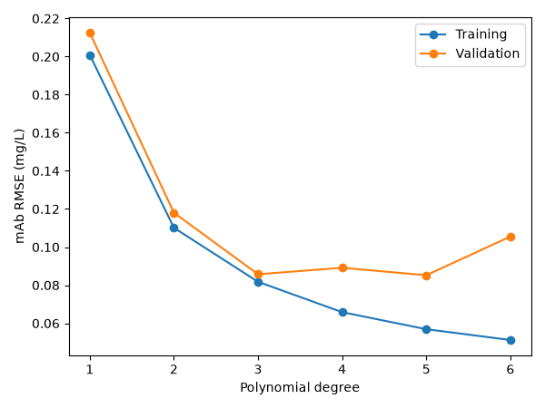
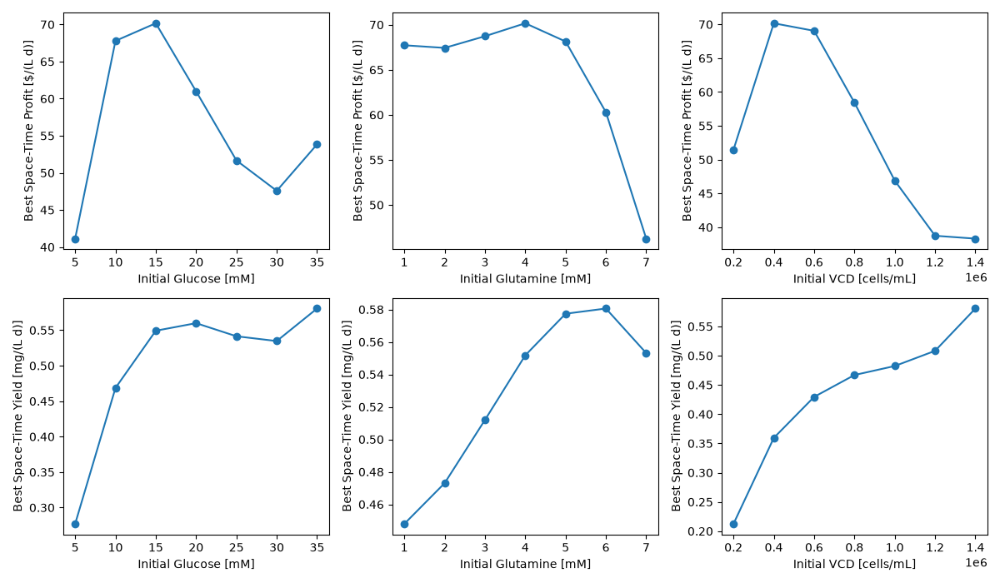
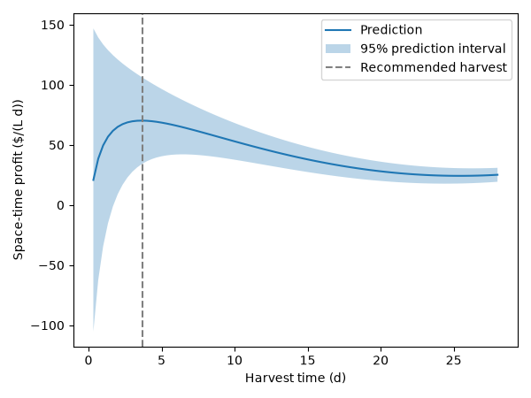

# mAb Production Optimizer

This project uses machine learning to predict monoclonal antibody (mAb) production in a batch cell culture and to find 
the optimal operating conditions. From only 30 batch experiments, a regression model predicts mAb concentration from the 
initial glucose, glutamine, and viable cell density, and the harvest time. The program then identifies the conditions 
that maximize the space-time profit of the process, with 95% prediction intervals.

## Highlights

- Designed a 30-run experimental plan using a 3-level full factorial design
- Combined 31 CSV files into a single dataset with pandas
- Compared polynomial and k-nearest neighbors regression using batch-grouped cross-validation
- Optimized initial conditions and harvest time across 29,000 combinations

## Environment

- Python 3.14.7
- matplotlib 3.11.0
- pandas 3.0.5
- scikit-learn 1.9.0

## Code Design

When `main.py` is executed, the program runs a complete workflow: it loads the batch data, calculates the economics of 
each batch, trains and compares regression models, searches for the most profitable operating conditions, and exports 
the results. Each stage is described below.

### Configuration

All fixed settings are stored in `src/constants.py`: the list of the 30 selected batches, the file paths, the cost and
value coefficients of the process, the 1-day downtime, the cross-validation settings, the hyperparameter values to test, 
and the levels used in the final search. Keeping these values in one place makes them easy to find and change without 
editing the rest of the code. For example, adding a new batch to the dataset only requires adding its ID to one list.

### Data Loading

The initial conditions of each batch are stored in one file, while the measurements over time are stored in 30 separate files.
The program reads each batch file, adds the initial glucose, glutamine, and viable cell density of that batch to every row,
converts the time from hours to days, and combines all batches into a single table of 2,550 measurements. This step is necessary 
because the model needs all four inputs (the three initial conditions and the time) on each row to learn how they affect mAb concentration.

### Economic Calculations

The `calculate_economics` function translates the process economics into code. From the initial conditions, the mAb concentration, 
and the harvest time, it calculates the cell culture cost, the cell culture value, the space-time profit, and the space-time yield.
Dividing by the harvest time plus the 1-day downtime is essential, because a batch that runs longer occupies the bioreactor and delays the next batch.
The function is first applied to the 30 measured batches to identify the most profitable batch observed, and it is reused later for every predicted scenario, so the same formulas are applied everywhere.

### Model Tuning

Two regression models are compared: polynomial regression and *k*-nearest neighbors (kNN). Both are built as scikit-learn 
pipelines that first standardize the four inputs, since initial VCD (hundreds of thousands of cells/mL) would otherwise dominate glucose and glutamine (a few mM).
`GridSearchCV` tests polynomial degrees from 1 to 6 and values of *k* from 1 to 40. Each option is evaluated with 5-fold `GroupKFold` cross-validation,
which keeps all measurements from the same batch in the same fold. This matters because the 85 measurements of a batch are very similar to each other:
if some were used for training and others for validation, the model would appear more accurate than it really is.
With grouping, every validation score reflects how well the model predicts a batch it has never seen.

### Optimization

The 30 batches only cover three levels of each initial condition, so the best conditions may lie between the tested values.
The final degree-3 polynomial model is therefore trained on all 30 batches and used to predict mAb concentration for every combination 
of seven glucose levels, seven glutamine levels, seven initial cell densities, and 84 harvest times (every 8 h up to 28 days), which is about 29,000 scenarios.
For each scenario, the program calculates the cost, value, space-time profit, and space-time yield, and ranks the scenarios from the highest to the lowest profit.
A 95% prediction interval is also calculated for each prediction as ±1.96 times the cross-validation error of the model, which shows how much the actual result could vary.

### Exporting Results

Finally, the program saves its results as files so they can be reviewed later and used as evidence. Three tables are exported to the `tables` folder:
the training and validation errors for each polynomial degree, a comparison of the best polynomial and kNN models, and the ten most profitable scenarios.
Three figures are exported to the `figures` folder: the validation curve of the polynomial model, the best achievable profit and yield for each level of each initial condition, and the space-time profit over harvest time for the recommended conditions.
These files support the analysis below.

## Analysis

### Experimental Design

Only 30 of the 1,029 available batch runs could be used, so the batches were chosen as a planned experiment rather than 
at random. Each initial condition was tested at three levels: low, middle, and high (glucose: 5, 20, and 35 mM; glutamine: 1, 4, and 7 mM; initial VCD: 200,000, 800,000, and 1,400,000 cells/mL).
All 27 combinations of these levels were included, which is a 3-level full factorial design.

This design was chosen for three reasons. First, it covers the full range of every condition. If only middle values had been tested,
the model would know nothing about the extremes, where the optimum could be. Second, three levels are the minimum needed to detect curvature: two levels can only describe a straight line, while three levels can reveal an optimum.
Third, testing every combination shows how the conditions interact with each other, for example whether a high cell density only pays off when enough nutrients are available.

The remaining three batches were used as replicates: two additional runs of the center point (20 mM glucose, 4 mM glutamine, 800,000 cells/mL) and one additional run of the high corner (35 mM, 7 mM, 1,400,000 cells/mL).
Repeating identical conditions shows how much the results vary because of experimental noise alone, and comparing the center and the corner checks whether this noise is similar across the design space.

The selected batch IDs are: 1, 10, 19, 64, 73, 82, 127, 136, 145, 442, 451, 460, 505, 514, 515, 516, 523, 568, 577, 586, 883, 892, 901, 946, 955, 964, 1009, 1018, 1027, and 1028.

### Model Selection

The model predicts mAb concentration from the initial glucose, initial glutamine, initial VCD, and time.
A degree-3 polynomial regression model was selected. As shown in the table and figure below, the training error always decreases as the degree increases,
but the validation error drops sharply up to degree 3 and then stops improving. Degree 1 and 2 are too simple to describe how mAb accumulates over time (underfitting).
Degree 5 reached almost the same validation error as degree 3 (0.085 compared with 0.086 mg/L), but it uses about 125 terms instead of 35. Since the two models perform equally well, the simpler degree-3 model was preferred because it is less likely to fit noise, and its predictions between the tested levels are more stable.

| degree | train_rmse | valid_rmse |
|--------|------------|------------|
| 1      | 0.201      | 0.213      |
| 2      | 0.110      | 0.118      |
| 3      | 0.082      | 0.086      |
| 4      | 0.066      | 0.089      |
| 5      | 0.057      | 0.085      |
| 6      | 0.051      | 0.106      |

The polynomial model was compared with *k*-nearest neighbors regression. The best kNN model (*k* = 4, distance weighting) had a validation error of 0.124 mg/L, about 45% higher than the polynomial model.

| model                                      | valid_rmse |
|--------------------------------------------|------------|
| Polynomial (degree 3)                      | 0.086      |
| kNN (*k* = 4, distance weighting)          | 0.124      |

This result is explained by the experimental design. Because only three levels of each condition were tested,
the closest training batches to an untested condition (for example, 15 mM glucose) are far away, at 5 or 20 mM.
kNN can only average these distant neighbors, while the polynomial model draws a smooth curve between the tested levels.
Since the goal is to predict conditions between the tested levels, the polynomial model is the better choice.

### Advantages and Limitations

The main advantage of the polynomial model is that it can predict conditions that were never tested, using smooth curves 
between the three tested levels. It is also simple, fast to evaluate, and its error was measured on batches it had never seen, thanks to grouped cross-validation.

The model also has limitations. First, it smooths the data. For the center-point conditions, the best measured batch reached
a space-time profit of 92 $/(L·d) after 3.3 days, while the model predicts a lower profit for the same conditions. The 
polynomial curve does not fully capture the fast mAb production of the first days, so the real optimum may be slightly more profitable than predicted.
Second, only three levels of each condition were tested, so predictions between them rely on the shape of the polynomial.
For example, the small increase in profit at 35 mM glucose is more likely an effect of the curve shape than real biology.
Third, the 95% prediction interval assumes the same error everywhere. Because profit is divided by the harvest time plus downtime, this error is strongly amplified for early harvests: the interval spans from about −100 to +150 $/(L·d) on the first day, but only a few dollars after 20 days.
Harvesting very early is therefore risky. Finally, the model was trained on simulated data within fixed ranges and should not be used outside them.

### Effect of Initial Conditions

The figure below shows the best achievable space-time profit (top) and space-time yield (bottom) for each level of each initial condition.

The space-time yield generally increases with more glucose, more glutamine, and more initial cells: more nutrients and
more cells produce more mAb per day. However, the space-time profit rises and then falls for all three conditions.
Beyond a certain point, each extra mM of glucose or glutamine, or each extra cell, costs more than the additional mAb it produces.
In other words, maximizing production is not the same as maximizing profit.

The initial VCD has the strongest effect on cost. At 800,000 cells/mL, the cells alone cost 400 $/L, which is more than 
the glucose and glutamine combined. Reducing the initial VCD to 400,000 cells/mL halves this cost while keeping a good production rate.
Glutamine also becomes costly above 5 mM, where the profit drops sharply, likely because it is the most expensive nutrient and excess glutamine produces ammonia, which is toxic to cells.
Glucose shows an optimum around 15 mM: too little limits growth, while too much adds cost without enough additional mAb.

### Recommended Conditions

The table below shows the recommended conditions and their predicted economics, with 95% prediction intervals.

| Parameter                                   | Recommendation         |
|---------------------------------------------|------------------------|
| Initial glucose concentration               | 15 mM                  |
| Initial glutamine concentration             | 4 mM                   |
| Initial viable cell density                 | 400,000 cells/mL       |
| Harvest time                                | 3.7 d (88 h)           |
| Cell culture cost                           | 430 $/L                |
| Cell culture value at harvest (95% PI)      | 757 $/L (589 to 925)   |
| Space-time profit (95% PI)                  | 70 $/(L·d) (34 to 106) |
| mAb space-time yield (95% PI)               | 0.16 mg/(L·d) (0.13 to 0.20) |

The figure below shows how the predicted space-time profit changes with the harvest time for these conditions.

The profit rises quickly during the first days, reaches its maximum at about 3.7 days, and then slowly decreases.
After this point, mAb continues to accumulate, but too slowly to justify keeping the bioreactor occupied instead of starting a new batch.
The curve is also quite flat between 3 and 5 days, which gives operators some flexibility in the exact harvest time with little loss of profit.
Since these conditions were never tested directly, the recommendation should be confirmed with a few validation batches before being used in production.